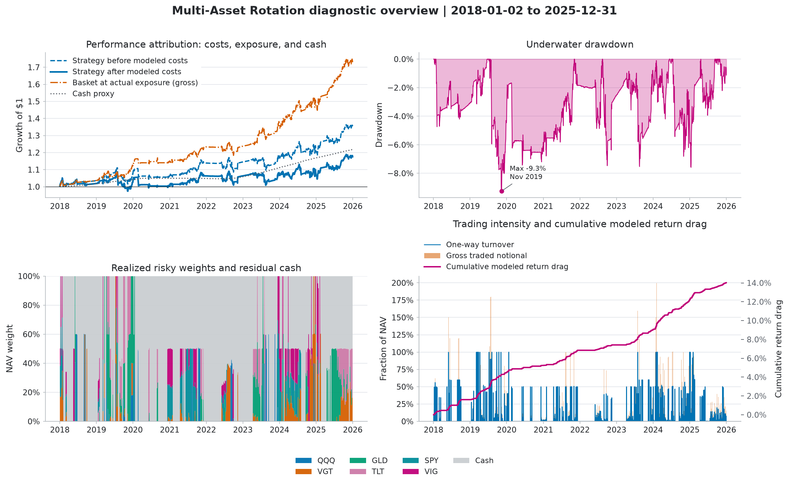

# QuantCortex

Python tools for portfolio research, backtesting, and paper trading.

[](https://www.python.org/)
[](LICENSE)
[](https://github.com/magnaprog/quantcortex/actions/workflows/ci.yml)

QuantCortex connects signals, portfolio allocation, exposure controls, simulation,
and broker adapters through a common set of portfolio weights. The same decisions
can be evaluated under different execution, cash, and trading-cost assumptions.
This makes it possible to examine how the evaluator affects a strategy comparison.

[Workshop paper](https://openreview.net/forum?id=Yjm9wkbzMb) |
[Contributor guide](docs/onboarding.md)

## Quick start

```bash
git clone https://github.com/magnaprog/quantcortex.git
cd quantcortex
python3.11 -m venv .venv
source .venv/bin/activate
python -m pip install -r requirements/dev.lock
python -m pip install --no-deps -e .
```

Run the offline paper-trading example:

```bash
PYTHONPATH=. python scripts/paper_trade_cycle.py --offline
```

This example uses synthetic inputs and makes no broker calls. To check the
installation:

```bash
python -m pytest tests/ -q --cov=quantcortex --cov-fail-under=60
ruff check .
PYTHONPATH=. python scripts/verify_brokers.py
```

Optional provider, broker, storage, and machine-learning libraries are imported
when used. Install the groups you need with Poetry; `poetry install --with test,dev -E all` installs every optional group. See the [contributor guide](docs/onboarding.md)
for environment setup and examples.

## Portfolio research

```text
data -> signals -> allocation -> exposure controls -> target weights
                                                     |-> backtest
                                                     `-> order plan -> risk checks -> broker
```

Allocators enforce their budget and weight bounds. Exposure controls can reduce
risky holdings and leave cash. In both backtest engines, a decision based on a
closing price executes at a later observed bar. Cash income is explicit, and
trading costs apply to executed purchases and sales.

The event engine holds accounting quantities between trades, allowing weights
to drift with prices. The vectorized engine holds weights between rebalances.
These conventions can produce different results. The
[architecture guide](docs/architecture.md) explains their interfaces and the
[performance guide](PERFORMANCE.md) defines the reported quantities.

To analyze your own permitted data, place it under ignored `local_data/` and use
an explicit price source:

```bash
PYTHONPATH=. python scripts/generate_report.py \
  --prices-csv local_data/published_rotation_prices.csv \
  --cash-proxy-symbol SHV
```

The named CSV is an input you supply; it is not included in the repository.
The [data guide](local_data/README.md) describes the columns and source records.
Reports go to ignored `reports/`. Research notebooks in [`research/`](research/)
also use an explicit local source or an opt-in provider download; Git stores
unexecuted notebooks.

## Research

Our [NeurIPS 2026 TAE workshop paper](https://openreview.net/forum?id=Yjm9wkbzMb)
examines how execution timing, cash returns, costs, and engine accounting affect
financial ML evaluation. The public library includes the accounting contracts,
strategy components, and synthetic tests used to check those conventions.

The [performance guide](PERFORMANCE.md) documents a historical rotation strategy
and explains how to generate a report from permitted data. Its positive nominal
growth falls short of SHV after costs. The study retains a known signal defect:
QQQ is regressed against itself, and a small positive floating-point residual can
receive a material weight after normalization. The results describe that
implementation and do not establish future alpha.



## Data and scope

The public repository contains source code, tests, unexecuted examples, and
performance-report charts with their source records. Manuscript and poster files
are maintained separately in the development repository. Raw provider matrices,
empirical allocation records, credentials, account state, and private review
material are excluded.

Exact empirical reproduction depends on the same permitted inputs and numerical
environment. Provider permission to publish derived results has not been
independently verified; the software license grants no rights to market data.
See the [data-source record](docs/data-source-due-diligence.md) for the documented
scope.

QuantCortex supports research and paper trading. Broker tests check request
construction and state handling with mocks and SDK models. Authenticated
connectivity, account permissions, execution quality, and operational recovery
need separate validation before deployment. The
[deployment checklist](docs/production-readiness.md) records those controls.

## Contributing

Start with the [contributor guide](docs/onboarding.md) and
[contribution instructions](CONTRIBUTING.md). Keep changes focused and add tests
for changes to timing, allocation, cash, costs, or order state. Use
[GitHub issues](https://github.com/magnaprog/quantcortex/issues) for questions and
bug reports. Report vulnerabilities through the private process in
[SECURITY.md](SECURITY.md).

## Citation

If you use QuantCortex in your research, please cite:

Jimmy Chan and Kevin Lee. **QuantCortex: Auditing Financial ML Backtests with Evaluation
Contracts and Executable Checks.** NeurIPS 2026 TAE workshop.
[OpenReview](https://openreview.net/forum?id=Yjm9wkbzMb).

```bibtex
@inproceedings{chan2026auditing,
  title     = {{QuantCortex}: Auditing Financial {ML} Backtests with Evaluation Contracts and Executable Checks},
  author    = {Chan, Jimmy and Lee, Kevin},
  booktitle = {Conference on Neural Information Processing Systems ({NeurIPS})
               Workshop: TAE (Trust-AI-Eval): Can We Trust AI Evaluation?},
  year      = {2026},
  url       = {https://openreview.net/forum?id=Yjm9wkbzMb}
}
```

## License

The [MIT License](LICENSE) covers the project software. Third-party materials
retain their own terms. Data access and redistribution permissions are separate
from the software license.
