# quantcortex

> Auditable quantitative research and guarded paper execution built around a
> common portfolio-weight contract.

[](https://www.python.org/)
[](LICENSE)
[](https://github.com/magnaprog/quantcortex/actions/workflows/ci.yml)

## Overview

quantcortex connects point-in-time data, alpha research, portfolio allocation,
timing and risk overlays, backtesting, and broker adapters through a single
representation: target weights. Research and paper execution use the same
contract, reducing interface drift between a backtest and an order plan.

```text
point-in-time data -> signals -> allocation -> overlays -> target weights
                                                        |-> backtest
                                                        `-> pre-trade risk -> broker
```

The main safeguards are:

- Targets formed from closing prices begin earning returns only after the next
  execution bar.
- Residual cash, costs, turnover, and comparator exposure share one capital clock.
- Allocators use a strict budget contract; overlays use a bounded exposure contract.
- Required audit inputs, future-dated records, and contract violations fail closed;
  documented strategy fallbacks remain explicit.
- Manifests record input, source, configuration, and artifact hashes for
  published outputs.

This is a research and guarded paper-execution platform. It is not a production
trading system, investment advice, or evidence that the included strategies add
alpha.

## Published Reference Audit

The reference study evaluates the six-ETF multi-asset rotation strategy from
2018-01-02 through 2025-12-31. Residual cash earns the return calculated from
SHV's adjusted closing prices. Strategy returns include a 13 bp charge on
executed buy and sell notional.

Exact attribution uses an equal-initial-weight buy-and-hold basket scaled ex post
to the strategy's actual daily risky exposure, before costs. A separate comparison
portfolio follows target risky exposure in the fixed basket with next-bar
accounting and its own trading costs.

A mature weekly decision with no positive selected-group residual momentum
remains in cash without switching to a second signal. The reference result uses
the event-driven engine. Its pseudo-shares are accounting units valued at
adjusted closing prices. Quantities stay fixed between trades, weights drift
with prices and NAV, and targets are sized against post-cost NAV.

The released results retain a known signal defect: QQQ is regressed against
itself, and a tiny positive floating-point residual can pass the positive-score
filter and receive a material weight after normalization. These results audit
that implementation; they do not evaluate a corrected signal.


| Audited result | Value |
|---|---:|
| Net nominal CAGR | +2.05% |
| Gross nominal CAGR before modeled costs | +3.86% |
| Net Sharpe relative to SHV | -0.04 |
| Gross Sharpe relative to SHV | +0.25 |
| Maximum drawdown | -9.25% |
| Annualized one-way turnover | 10.38x |
| Annualized gross traded notional | 13.51x |
| Mean risky exposure | 30.97% |
| Sessions entirely in cash | 46.89% |
| Basket at actual exposure: Sharpe before costs | +0.85 |
| Comparison portfolio following target exposure: Sharpe, after costs | +0.67 |
| Annualized arithmetic net excess over SHV | -0.26% |
| Active risky-allocation contribution | -3.05% |
| Dynamic exposure-timing contribution | +0.54% |
| Passive risky-exposure contribution | +4.00% |
| Modeled implementation-cost contribution | -1.76% |

The positive nominal return is not evidence of positive active return. Annualized
arithmetic return before costs relative to the basket at actual exposure is -3.05%; the primary 21-session paired block-bootstrap
interval is [-5.52%, -0.57%]. Against the comparison portfolio following target
exposure at the next bar,
with modeled costs on both paths, the strategy shortfall is -3.86%
[-6.40%, -1.35%]. The corresponding conventional active Sharpe is -0.86 with a
block-bootstrap interval of [-1.40, -0.31].

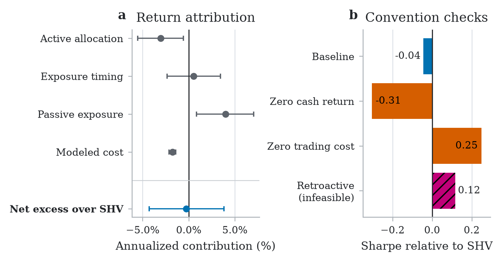

The left subplot decomposes net excess over SHV exactly into active allocation,
exposure timing, passive exposure, and modeled cost. Active allocation includes
security selection and the return effect of weight drift between rebalances.
Accounting quantities stay fixed between trades. The right subplot holds target
weights, input data, and the event engine fixed while changing one convention.
Orange bars change economic conventions. The magenta bar assigns a target formed
at the decision close to the return interval that ends at that close. The close
is observable when the decision is formed, but that assignment could not have
been executed. None of the bars is a candidate strategy.

### Core diagnostics

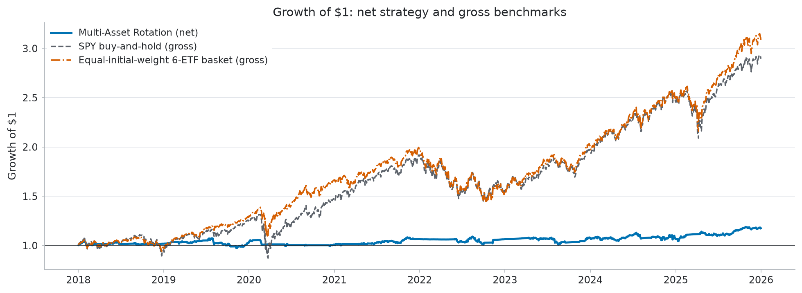

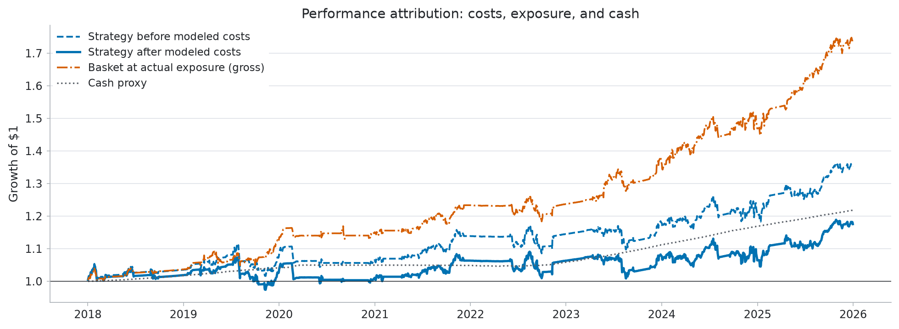

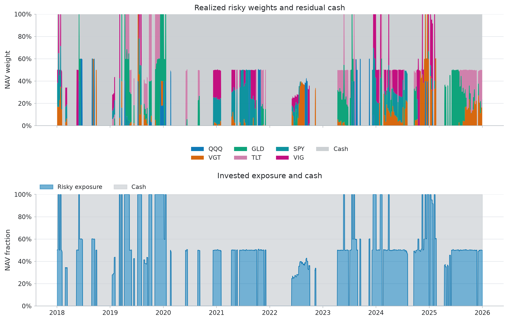

<details>
<summary><strong>Additional diagnostics</strong></summary>

#### Drawdown

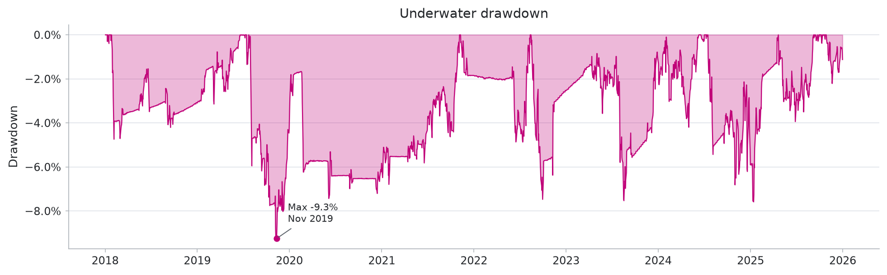

#### Rolling Sharpe

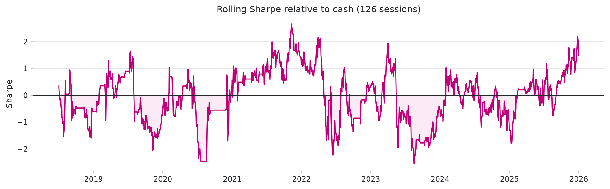

#### Rolling risk

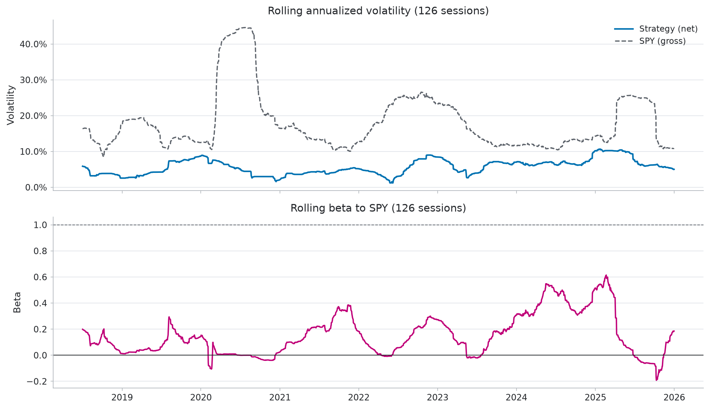

#### Turnover and costs

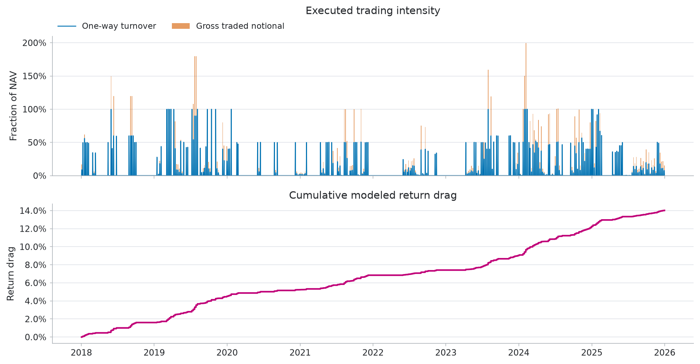

#### Monthly returns

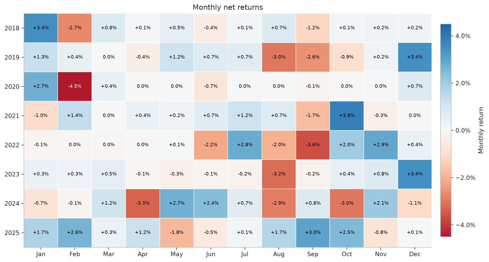

#### Return distribution

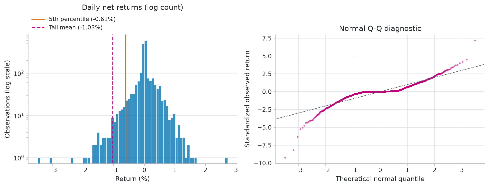

</details>

The repository owner authorizes publication of these derived charts. The raw
provider matrix is not committed. Its SHA-256 is
`9c499ec55c630b596aa724a78de36ee5d98a2edf453b534080e1ad105b46a9c4`.
Chart hashes and the same input digest are recorded in
[`docs/img/performance_manifest.json`](docs/img/performance_manifest.json).
That repository-owner authorization does not independently establish that the
provider's terms permit publication.

## Repository-Frozen Expansion

The protocol-freeze identifier refers to a private development commit. This
public snapshot preserves the protocol bytes and identifier, but does not expose
that commit or independently verify pre-data chronology. Public artifact
manifests identify the public source commit used for regeneration. Raw provider
matrices are not distributed; their absence prevents exact-input empirical
reproduction from this repository alone.

The paper also evaluates four fixed strategy families across U.S. sector and
country-equity ETF panels from 2018 through 2025. The recorded commit timestamp
precedes the recorded provider-request timestamps, but all are author-controlled.
The protocol was not externally registered, and the historical interval is not a
temporal holdout. All models use mature features, next-bar execution, SHV
residual cash, a 13 bp charge on executed buy and sell notional, and 5,000 joint
circular-block draws. Gradient boosting uses five fixed seeds; its reported
Sharpe is the mean of the individual seed Sharpes.

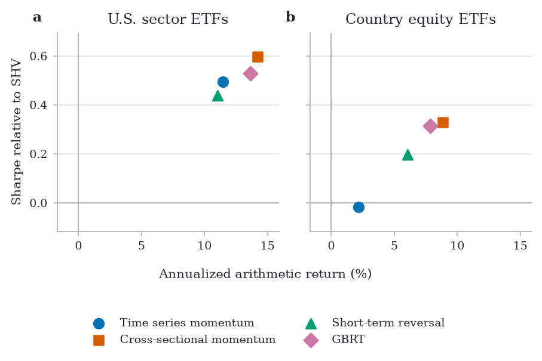

Seven of eight baseline sample Sharpes are positive. These descriptive outcomes
do not establish alpha. The main finding concerns sensitivity to evaluation
semantics:

| 21-session pointwise interval result | Cells out of 8 |
|---|---:|
| Removing modeled cost: interval entirely above zero | 8 |
| Closed-interval assignment: entirely below / includes zero / entirely above | 3 / 5 / 0 |
| Zero cash return: entirely below / includes zero / entirely above | 5 / 3 / 0 |
| Strategy minus comparison portfolio after costs: entirely below / includes zero / entirely above | 1 / 7 / 0 |

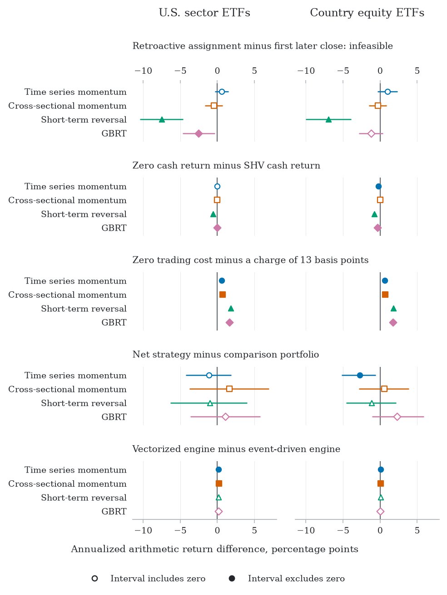

The intervals are pointwise, conditional on two selected panels, and not
multiplicity adjusted. Raw matrices are not distributed; panel digests, hashes of
allocation records, aggregate tables, source fingerprints, and figure hashes are in
[`paper/expansion/results/manifest.json`](paper/expansion/results/manifest.json).

## Research Paper

The tracked [NeurIPS 2026 TAE final paper](paper/quantcortex_audit_neurips2026.pdf)
documents a version-1 evaluation record, executable checks, an exact arithmetic
decomposition, and two historical studies. It uses the accepted workshop style and is not a NeurIPS main-proceedings
paper. The [official accepted-paper list](https://tai-eval.github.io/papers/)
confirms Submission 423 at the non-archival NeurIPS 2026 TAE workshop. This
repository does not establish which PDF is currently uploaded to OpenReview.
`paper/submission.tex` builds the same identified
camera-ready format for that workshop. The tracked
[anonymous preprint](paper/quantcortex_audit_anonymous.pdf) is a separate review
build. It still suppresses author, repository, system-name, and exact
fingerprint identifiers.

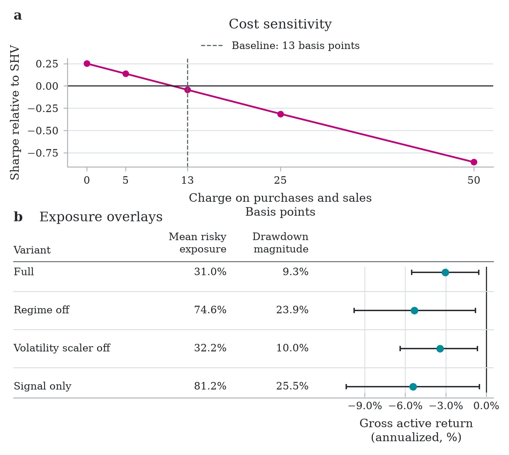

See [paper/README.md](paper/README.md) for the build and reproduction workflow.
Aggregate tables, generated paper values, source fingerprints, and artifact
hashes are committed under `paper/results/` and `paper/expansion/results/`.

The current manuscript includes 13 figures. Two descriptive analyses added
during revision show annual excess returns over SHV and convention effects for
each gradient boosting seed. They reuse the recorded paths without changing
the frozen primary protocol.
The convention figures group strategies by the accounting comparison. Seed
plots show individual gradient boosting outcomes alongside the rules; engine
diagnostics
separate extreme daily discrepancies from terminal wealth differences for
each path. Appendix Table 7 reports interval counts for block lengths of 5, 21,
and 63 sessions.

## Quick Start

```bash
git clone https://github.com/magnaprog/quantcortex.git
cd quantcortex
python3.11 -m venv .venv
source .venv/bin/activate
python -m pip install -r requirements/dev.lock
python -m pip install --no-deps -e .
```

Run the same offline gates used by CI:

```bash
python -m pytest tests/ -q --cov=quantcortex --cov-fail-under=60
ruff check .
PYTHONPATH=. python scripts/verify_brokers.py
```

Poetry extras install optional provider and storage clients, broker SDKs, and
dependencies for NLP, gradient boosting, and reinforcement learning. These remain
lazy imports so the scientific core can run without credentials or native ML
runtimes.

```bash
poetry install --with test,dev -E all
```

On macOS, LightGBM and XGBoost may require `brew install libomp`.

## Research Workflows

Local market data belongs under ignored `local_data/`; schemas and provenance
requirements are documented in [local_data/README.md](local_data/README.md).
The repository never replaces a failed real-data load with generated performance
numbers.

```bash
# Generate the ten-plot local performance report.
PYTHONPATH=. python scripts/generate_report.py \
  --prices-csv local_data/published_rotation_prices.csv \
  --cash-proxy-symbol SHV
```

Source commits require explicit user approval. After approval, commit reviewed
release-critical source, then run expansion first and paper second from that same
source commit, with no intervening commit. Changed source or inputs require fixed
UTC timestamps for both wrappers; replace the placeholders below. This example
retains reviewed inputs and provenance: leave input-digest and provenance overrides
unset unless new inputs are separately authorized. It does not authorize refetching
data or publication. See the [coordinated release flow](paper/README.md#coordinated-release).
Set the absolute Python path from the repository root for the detached worktrees:

```bash
export PYTHON_BIN="$PWD/.venv/bin/python"
# Regenerate expansion aggregates and figures first.
QUANTCORTEX_EXPANSION_GENERATED_AT="YYYY-MM-DDTHH:MM:SSZ" \
  scripts/release_expansion_artifacts.sh local_data/expansion &&
# Regenerate README charts and paper artifacts second.
QUANTCORTEX_GENERATED_AT="YYYY-MM-DDTHH:MM:SSZ" \
  scripts/release_paper_artifacts.sh local_data/published_rotation_prices.csv
```

For unchanged reviewed source and inputs, omit both generation-timestamp overrides
to reuse recorded source commits and timestamps.

```bash
# Explicit live-data diagnostics; review the provider's terms first.
python scripts/validate_performance.py --live-yfinance
python scripts/survivorship_demo.py --live-yfinance

# Full offline research-to-order lifecycle; no broker calls.
python scripts/paper_trade_cycle.py --offline
```

Research notebooks are unexecuted in Git. CI executes them on deterministic
synthetic fixtures and checks that figures render. For research runs, choose
exactly one adjusted-close source: `QUANTCORTEX_PRICES_CSV` or
`QUANTCORTEX_LIVE_YFINANCE=1`. A local run of the Alpha158 notebook also needs
`QUANTCORTEX_OHLCV_CSV`. To run the full notebook set from local files:

```bash
export QUANTCORTEX_PRICES_CSV="$PWD/local_data/prices.csv"
export QUANTCORTEX_OHLCV_CSV="$PWD/local_data/aapl_ohlcv.csv"
jupyter lab research/
```

Live yfinance use requires the explicit `QUANTCORTEX_LIVE_YFINANCE=1` opt-in
and remains subject to the provider's terms.

## Architecture

Importable code lives under the single `quantcortex` package.

| Layer | Responsibility |
|---|---|
| `data` | Provider adapters, local CSV validation, calendars, PIT merges, storage, universes |
| `alpha` | Classical, ML, and NLP factors plus validation utilities |
| `portfolio` | Weight contracts and portfolio allocators |
| `timing` | Regime, momentum, and volatility exposure overlays |
| `risk` | Drawdown, VaR/CVaR, factor, volatility, and Kelly controls |
| `backtest` | Vectorized/event-driven engines, costs, fills, metrics, research validation |
| `execution` | Pre-trade risk, order translation, broker adapters, coherent state persistence |
| `strategies` | End-to-end strategy pipelines using the shared contracts |

See [docs/architecture.md](docs/architecture.md) for module boundaries,
accounting semantics, and extension rules.

## Safety and Scope

The validation workflow covers unit tests, lint, source and artifact hashes,
package installation, notebook execution on synthetic fixtures, and container
smoke tests. Broker checks cover request construction and order-state handling
with mocks and SDK models. Results for each public commit appear in
[GitHub Actions](https://github.com/magnaprog/quantcortex/actions).
These checks leave the following operational questions open:

- authenticated broker connectivity, permissions, or venue-side idempotency;
- production data rights, delisted-security coverage, or exact filing timestamps;
- calibrated spread, capacity, or market-impact estimates;
- operational recovery, monitoring, incident response, or regulatory approval.

Treat the unresolved controls in
[docs/production-readiness.md](docs/production-readiness.md) as release blockers
before using production capital. Security reporting is documented in
[SECURITY.md](SECURITY.md).

## Documentation

- [PERFORMANCE.md](PERFORMANCE.md): metric definitions, reporting rules, and limitations
- [docs/architecture.md](docs/architecture.md): package and contract design
- [docs/evaluation-contracts.md](docs/evaluation-contracts.md): schema for allocation records and evidence classes
- [docs/data-source-due-diligence.md](docs/data-source-due-diligence.md): publication-data acceptance rules
- [docs/production-readiness.md](docs/production-readiness.md): external release gates
- [paper/README.md](paper/README.md): paper reproduction and submission constraints
- [paper/COMPUTE.md](paper/COMPUTE.md): historical host and release wall times
- [paper/preregistration.md](paper/preregistration.md): repository-frozen expansion protocol; not an external registry entry
- [local_data/README.md](local_data/README.md): accepted local-data schemas and provenance
- [CONTRIBUTING.md](CONTRIBUTING.md): contribution workflow
- [AGENTS.md](AGENTS.md): concise repository guidance for coding agents
- [CLAUDE.md](CLAUDE.md): detailed implementation constraints

## License

The project software is licensed under the [MIT License](LICENSE). That software
license does not grant rights to provider data or override third-party notices
for the NeurIPS template and other included materials. Publication of empirical
artifacts requires its own reviewed rights basis. Past simulated performance
does not imply future results.
